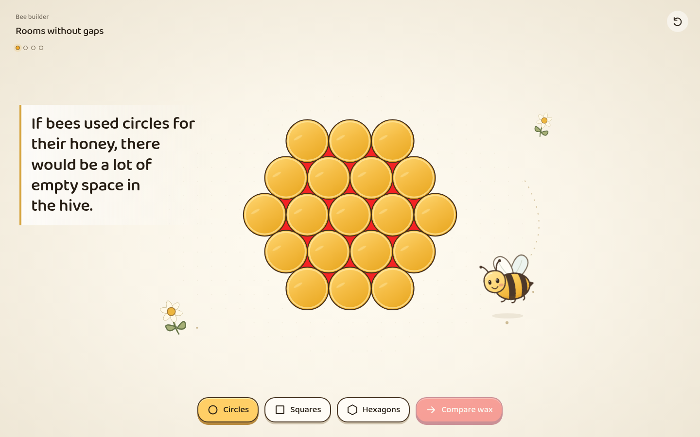

# Bee Builder

[Run the experience](experience.html) · [Example index](../../references/examples.md)

[Central interaction](screenshots/interaction.png) ·
[Independent task before reveal](screenshots/assessment.png) ·
[Feedback](screenshots/feedback.png) · [Narrow layout](screenshots/narrow.png)

## Goal and representation

Around age nine, explore why hexagonal honeycomb is useful: no gaps between
rooms and less boundary length than equal-area squares or equilateral triangles.
Related anchors include `mt_zuOGOGFAKb` (shape attributes), `mt_wE7-Gs9ENL`
(Measuring Perimeters) and `mt_WtcFrxGOgw` (Perimeters of polygons). This is an
informal application, not mastery of all those topics or perimeter formulas.

Use this as the **2D counterexample to unnecessary 3D**. The target reasoning is
planar packing, equal area and boundary length. SVG gives exact geometry,
large scene targets and a crafted illustrated bee without camera complexity.

## Learning sequence and evidence

Explore circle gaps and square/hexagon packing. Compare equal-area rooms by
unfolding their boundaries into strips at a common scale. Join two rooms to see
why a shared wall is built once. Then place a fourth hexagon to share more walls,
and predict which of a fresh equal-area square/rectangle pair needs less wax.
The second task applies boundary reasoning without merely choosing a hexagon
again. Direct scene taps commit; buttons allow preview and explicit commitment.

First responses in both tasks must be correct without Help for the positive
independent-session message. Reveals, assistance and later challenge rounds
cannot retroactively count as first independent success. The no-gap property is
explored but not independently assessed. These two choices are modest evidence
of shared-wall and boundary reasoning, not a proof, open explanation or retention.
Optional triangles transfer the comparison without altering the core result.

## What to inspect and reuse

- [Application](source/app.js): `vertices`, `perimeter`, `unfold` connect displayed
  shapes and strips; `sharedWalls`, `commit` and `showFinish` connect geometry to
  evidence. `tapTarget` adds keyboard-operable SVG actions.
- [Shell](source/shell.html): responsive framing, tactile buttons and typography.
- The bee's hinged wing motion, quiet shadow and deliberate silhouette illustrate
  craft; adapt this attention to detail rather than reusing a bee everywhere.

## Limits and exceptions

Equal area implies equal capacity only with equal cell depth. Fixed thickness
lets boundary length stand for side-wall wax; bases, structural constraints and
real wax variation are omitted. Shared interior walls count once in construction:
outer perimeter alone is not the total amount of wax. Hexagons are compared with
specific regular tilings, not proved optimal over every conceivable partition.

This explains geometric advantages, not the biological mechanism of construction;
never claim bees consciously calculate an optimum or that this simulation models
wax physics. The snapshot's activity label plus stage title differs from the
current single-title budget. Preserve the current rule for new work unless an
exception is agreed. The opening packing picture is intentionally passive;
buttons change shapes, while later room targets support direct action. See
[capture notes](screenshots/notes.md) for actual checks, not effectiveness evidence.
