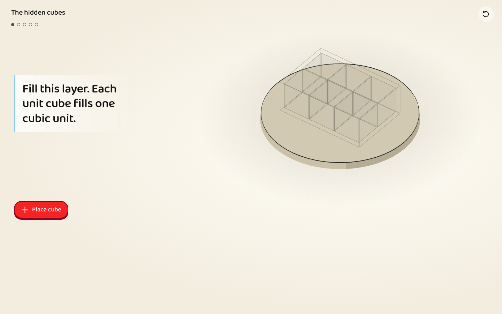

# Hidden Cubes

[Run the experience](experience.html) · [Example index](../../references/examples.md)

[Central interaction](screenshots/interaction.png) ·
[Independent task before reveal](screenshots/assessment.png) ·
[Feedback](screenshots/feedback.png) · [Narrow layout](screenshots/narrow.png)

## Goal and representation

Count all unit cubes in a filled rectangular solid, including cubes hidden by
viewpoint and fully buried cubes, by structuring the solid into layers. The main
taxonomy anchor is `mt_d7XktBQPxm` (Counting Unit Cubes). Check current topic names
and prerequisites rather than copying older volume/capacity mappings.

A manipulable Three.js block can be filled, rotated and opened into layers.
Colour and black edges make individual units and layer structure legible. The
learner can count or add layer totals; multiplication fluency is not assumed.

## Learning sequence and evidence

Fill a six-cube layer, stack it to make 18 cubes, then visibly add nine cubes to
make a different 3 × 3 × 3 block with a fully buried centre. This matters: a
3 × 2 × 3 block has no fully buried cube, even if some cubes are hidden by view.

For fresh solids, enter cubes per layer, number of layers and total in a single
labelled equation. Commit before the layers open. A correct total with wrong
factors does not pass; help preserves entries but marks the attempt assisted.
Three stages cover a small solid, fully buried cubes and a changed long/thin
shape. Incorrect or assisted work stays at its stage and receives a fresh case.

The 39-shape bank excludes shapes already used in teaching/checks, including
rotations of the same dimensions. Restart resets this local history; it does not
prove a learner has never seen a task. Completion is evidence of layer plans
within this session, not spontaneous strategy selection or retained mastery.

## What to inspect and reuse

- [Application](source/app.js): `fillAt`, `discover`, `renderEquation`,
  `revealCheck`, `frameScene`; inspect locked responses and visual layer feedback.
- [Task bank and scoring](source/tasks.js): `shapeKey`, `chooseTask`, `scorePlan`,
  `advances`; model freshness and progression independently of the render loop.
- [Shell](source/shell.html): current shared CSS plus the equation layout.

## Limits and exceptions

The visible equation and field labels are an **author-agreed mathematical-text
exception**. Agree equivalent task-specific text explicitly in a new experience;
do not generalize it into extra explanatory cards. The supplied multiplication
structure scaffolds the strategy, so successful entries do not demonstrate that
the child invented or independently selected it.

Scene-adjacent Turn/Open layers buttons supplement direct gestures for access;
they are not a reason to replace direct manipulation with an external control
panel. Nonvisual spatial learning and physical mobile keyboard use have not been
validated. Optional rearrangement illustrates conservation of volume but is not
included in core assessment evidence. See [capture notes](screenshots/notes.md)
for current browser checks; effectiveness with a child remains unestablished.
