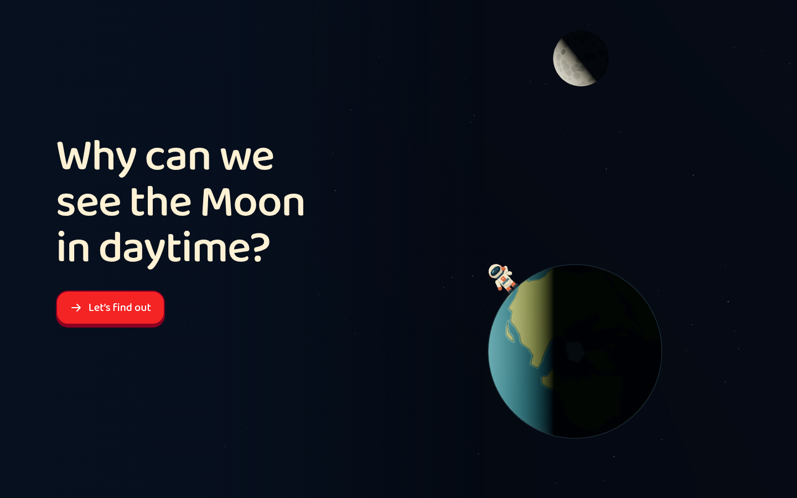

# Moon Visit

[Run the experience](experience.html) · [Example index](../../references/examples.md)

[First lesson screen](screenshots/lesson-entry.png) ·
[Central interaction](screenshots/interaction.png) ·
[Independent task before reveal](screenshots/assessment.png) ·
[Feedback](screenshots/feedback.png) · [Narrow layout](screenshots/narrow.png)

## Goal and representation

For a learner around seven, connect reflected sunlight with the possibility of
seeing the Moon during daytime. Related taxonomy anchors are `mt_PiWZA8Z0ZJ`
(Sun, Moon & Stars) and `mt_15FduGRf5c` (The Moon's Orbit); this is narrower than
mastery of either topic. Identifying Earth, Moon and Sun is the starting point.

The learner turns Earth, then changes from a space overview to an observer's
local sky. Those views share model state. Looking around changes the camera,
not the positions used to decide whether the Moon is above the horizon.

## Illustrated opening

The opening asks **“Why can we see the Moon in daytime?”**, composed with a separate composition of the existing Earth, Moon and explorer models, with the shared matte lighting.
One icon-plus-label “Let’s find out” action enters fresh practice; lesson controls
remain hidden and inert until then. Restart returns to the opening and clears
session evidence. The cover introduces the investigation without awarding credit
or revealing an independent answer. Its large question is the approved exception
to the lesson's small-title typography.

The [shared opening UI](../opening.mjs) supplies the accessible start and focus
behavior; the application stages its own 3D illustration. Cover objects and poses
are illustrative, not an assessed task or additional physical model.

## Learning sequence and evidence

Explore a daytime view, trace sunlight from Sun to Moon to observer, then predict
visibility in four fresh configurations before viewing the sky. Finally construct
the three-object light path independently. Practice rings, rays and observer
views are withheld in the independent phase; a hint records assistance.

The session's positive result requires the first four predictions to be correct
without help and the first causal path to be correct without help. A revealed
answer cannot be resubmitted for independent credit. These observations check
visibility reasoning and a selected causal sequence, not a spontaneous explanation,
retention, phase knowledge or actual sky observation. Binary predictions remain
guessable; do not import this exact count or all-correct rule as a default.

## Contextual vocabulary

Technical terms have dashed underlines in non-interactive child-visible copy,
including the opening question where relevant. Action controls and their labels
are excluded. Hover, tap or keyboard focus opens one
brief meaning. These are generic language explanations, not task-specific hints;
opening them does not submit a response or change this experience's evidence.
Button and form labels retain their original accessible names and actions.

[Desktop word help](screenshots/vocabulary.png) ·
[Phone word help](screenshots/vocabulary-narrow.png) ·
[Shared vocabulary source](../vocabulary.js)

## What to inspect and reuse

- [Application](source/app.js): `toSky`, `predict`, `tapObject`, UI state and
  transitions; compare camera movement with physical model updates.
- [Geometry and evidence](source/model.mjs): `facts`, `makeTasks`, `scorePath`,
  `sessionEvidence` separate subject rules from presentation.
- [Observer view](source/ground-view.mjs), [landscape](source/ground-landscape.mjs)
  and [space effects](source/space-visuals.mjs): coherent directions at two scales.
- [World artwork](source/world-visuals.mjs): the original simplified continental
  atlas, dark globe silhouette and articulated explorer. Earth uses the same
  matte material and scene lighting as the Moon, giving a curved daylight falloff
  into an almost-black night side. This user-approved shading choice is an
  example-specific exception to the default stepped cel-shading direction.
- [Shell](source/shell.html): typography, in-object labels and narrow layout.

## Limits and exceptions

Distances, body sizes and apparent diameters are compressed or enlarged. This
is a visibility model, not a date-specific sky map or a promise of visibility on
any real day. Clouds, brightness thresholds, eclipses and refraction are omitted.
The atlas is illustrative rather than a geography teaching map. The explorer is
an enlarged observer marker, with graphic fill lighting for legibility and a
larger silhouette on phones. Sun effects and the continuous globe/Moon shading
differ from the current flat, outlined cel-shading benchmark. A hidden-Moon locator is an annotation, not a
Moon physically seen through Earth.

A fresh 390 × 844 mobile-emulation load is readable. The preceding revision
showed severely undersized text when switching from desktop to that viewport
in the browser harness; the historical
[resize failure](screenshots/narrow-after-resize.png) is retained separately.
This refresh did not re-audit that transition.
Check resize/orientation transitions and actual text size when adapting this
layout; physical-device behavior remains unverified.

The snapshot includes a timed feedback toast alongside the instruction. **Do not
copy that duplication:** new work replaces the single instruction with feedback.
Use the current component styling rather than treating every snapshot detail as
approved general guidance. Original companion validation notes are historical;
see the current [capture notes](screenshots/notes.md) for this import's checks.
