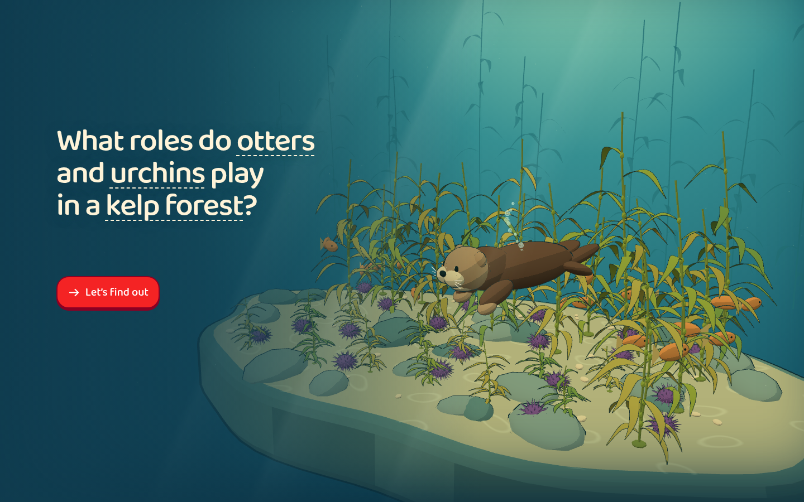

# Otter Forest

[Run the experience](experience.html) · [Example index](../../references/examples.md)

[First challenge](screenshots/lesson-entry.png) ·
[Intervention](screenshots/interaction.png) ·
[Reflection before response](screenshots/assessment.png) ·
[Feedback](screenshots/feedback.png) · [Phone opening](screenshots/narrow.png)

## Goal and representation

Investigate how changing predators can change grazers and plants indirectly,
then predict the causal relationships behind the observed result. The original
learner context was around age 12. Consulted taxonomy anchors are
`mt_NPTjGJIyb3` (Predator Loss and Ecosystem Effects) and `mt_OnV_DTp5i8`
(Ocean Food Webs), with food-chain understanding as a prerequisite. Resolve
these against current taxonomy/research before adapting the activity.

A crafted Three.js underwater scene represents individual animals moving,
feeding and competing, with visible plant growth and loss. The central
question is **“What roles do otters and urchins play in a kelp forest?”**.
Its illustrated opening uses the actual scene, with one start action and no
assessment credit. The lesson uses the small title and prominent instruction.
This is a reference for emergent behavior and indirect effects, rather than a
fixed animation that plays a predetermined ecological outcome.

## Learning flow and evidence

Guided observation follows an otter hunting and an urchin grazing. The learner
then removes and adds an otter, restores kelp, and orders a food chain. This
supported discovery establishes the controls and relationships; it is separate
from later reflection evidence.

The menu offers a suggested progression without locking investigations into a
required order. Learners can return to unfinished worlds, revisit discovery or
choose unscored exploration. This makes Otter a reference for nonlinear learning
flows, rather than a fixed tutorial–quiz sequence.

Four freely selectable investigations range from recovering kelp to keeping
a community, restoring an eelgrass meadow, and sharing a rocky coast. The
latter connects otters, sea stars, mussels, urchins and kelp: alternate prey and
shared prey complicate a simple “more predators is better” rule. Free
exploration also offers all three ecosystems without assessment.

Drag or tap tray organisms to add them, and tap life in the water to remove it.
Keyboard alternatives support adding and removing without precise dragging.
Drag the water to orbit the reef; pinch or use the mouse wheel to zoom. With
the scene focused, arrow keys rotate, plus/minus zoom, and R resets the view.
Once a drag or pinch begins, releasing a finger does not become a removal tap.
Starting discovery restores the default view.
Pause and speed controls make slow changes inspectable. Explicit goal
requirements and an observation timer show what must persist together. Editing
resets the held-goal interval. An achieved goal records a past observation; it
does not promise the ecosystem will remain stable indefinitely.

The “Left alone” comparison advances an unedited copy from the same initial
state for the same elapsed model time. “Last attempt” instead shows its own
stopping point and says so. Replay restores the original starting world;
returning through the menu preserves each investigation's in-memory session.
These distinctions matter when borrowing the comparison interaction.

After goal achievement, two committed multiple-choice reflections ask about
causes and predictions. Incorrect responses receive an explanation. Answer-
revealing help marks reflection evidence assisted; both correct responses
without that help are required for the positive reflection result. Repeating
revealed questions does not retroactively turn earlier errors into independent
success. Question-exposure history survives investigation replay within the
session, and revisiting reflection cannot erase an earlier independent success.
Goal achievement and reflection results remain separate.

This is narrow evidence of recognizing causal relationships within this
session. The fixed questions, preceding discovery and repeated contexts do not
establish spontaneous explanation, unseen transfer, retention or broad mastery.
New activities should design fresh transfer evidence for their own goals.

## Contextual vocabulary

The [local ecology lexicon](source/vocabulary.js) supplies dashed inline word
help with hover, tap and keyboard access. Definitions explain language rather
than the current answer. Organism tokens are action buttons: their words add or
drag the organism without opening definitions. Word help remains in non-interactive lesson text. Live goal values
update without rebuilding their labels, preserving an open definition.

[Desktop word help](screenshots/vocabulary.png) ·
[Phone word help](screenshots/vocabulary-narrow.png)

## What to inspect and reuse

- [Model](source/model.mjs): deterministic stepping, local feeding interactions,
  food reserves and plant/grazer dynamics, separate from rendering.
- [Challenges](source/challenges.mjs): goal predicates shared with visible
  requirements, held-goal observation, question bank and explanatory feedback.
- [Application](source/app.js): discovery, intervention controls, session state,
  matched-time comparison, replay and separate reflection evidence.
- [Visuals](source/visuals.js) and [animation](source/otter-animation.mjs):
  procedural underwater artwork, animal poses, scene picking and bounded
  orbit/zoom controls.
- [Shell](source/shell.html): responsive layout and topic-specific goal UI.

## Limits and exceptions

This is a **qualitative teaching model**, not a calibrated ecological forecast.
Rates, population thresholds and elapsed units are illustrative; units are not
real days or years, and goal thresholds are not conservation standards. Do not
present a successful intervention recipe as a real restoration recommendation.
Eelgrass shelter effects and rocky-coast diet interactions simplify ecological
relationships. Displayed fish illustrate habitat use rather than a complete
population model; gauge lengths use different scales and are not population
ratios. Review the mechanisms and teaching research before transferring them
to a different ecosystem.

Goal requirements, timer, food-chain tokens and response choices are
**topic-specific functional text**, not permission to fill new lessons with
explanation panels. The existing snapshot also has longer instructions and
help notices; adapt the underlying mechanism while following the current
skill's copy and visual rules.

See [capture notes](screenshots/notes.md) for the bounded browser checks and any
arranged assessment state. There is no child study, physical-device validation
or evidence of learning effectiveness. The snapshot contains no learner data,
requires no network at runtime, and stores session evidence in memory only.
