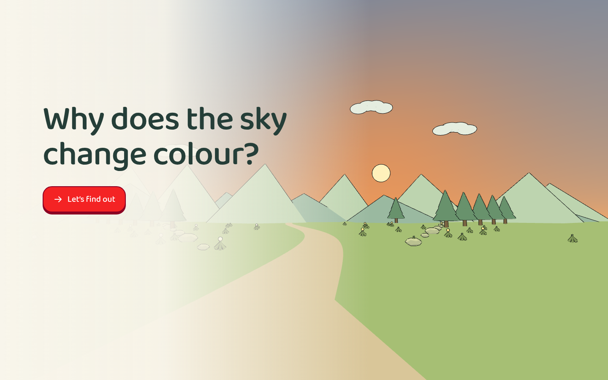

# Sky Colour Explorer

[Run the experience](experience.html) · [Example index](../../references/examples.md)

[First lesson screen](screenshots/lesson-entry.png) ·
[Central interaction](screenshots/interaction.png) ·
[Independent task before reveal](screenshots/assessment.png) ·
[Feedback](screenshots/feedback.png) · [Narrow layout](screenshots/narrow.png)

## Goal and representation

A qualitative introduction, designed around age six: relate the blue sky to
stronger scattering of short-wavelength light, and warm colours near a low Sun
to a longer path through air. Related anchors include `mt_4i-FKXDDXh` (Light &
Seeing in the Dark) and a small part of `mt_qzGADV-NGe` (White Light & Colour).
The latter's full older-age curriculum is not a prerequisite or claimed outcome.

A curved atmospheric cutaway and observer view connect an invisible mechanism
to a familiar appearance. Draggable Sun placement changes path geometry. Colours,
paths, pacing, particle effects and the explorer's eyes direct attention together.

## Illustrated opening

The opening asks **“Why does the sky change colour?”**, composed with a warm observer landscape using the existing 3D scenery and an independent sky material.
One icon-plus-label “Let’s find out” action enters fresh practice; lesson controls
remain hidden and inert until then. Restart returns to the opening and clears
session evidence. The cover introduces the investigation without awarding credit
or revealing an independent answer. Its large question is the approved exception
to the lesson's small-title typography.

The [shared opening UI](../opening.mjs) supplies the accessible start and focus
behavior; the application stages its own 3D illustration. Cover objects and poses
are illustrative, not an assessed task or additional physical model.

## Learning sequence and evidence

Introduce the colours in white light and what scattering means, then contrast
selected blue/red paths for high and low Sun positions. Give the learner control,
then ask three committed predictions: which colour scatters more, which Sun
position gives the longer path, and what to expect near a low morning Sun.
The sunrise case transfers the path idea beyond an evening example. Hide
answer-revealing sky colours and paths until commitment; record Help separately.

All three first responses must be correct without assistance for the positive
session message. Mirrored layouts vary subsequent rounds but do not establish
unseen conceptual problems or retained mastery. Selected colours and positions
are limited evidence, not a free explanation of atmospheric optics. Other-world
views are exploratory and unscored.

## Contextual vocabulary

Technical terms have dashed underlines in non-interactive child-visible copy,
including the opening question where relevant. Action controls and their labels
are excluded. Hover, tap or keyboard focus opens one
brief meaning. These are generic language explanations, not task-specific hints;
opening them does not submit a response or change this experience's evidence.
Button and form labels retain their original accessible names and actions.

[Desktop word help](screenshots/vocabulary.png) ·
[Phone word help](screenshots/vocabulary-narrow.png) ·
[Shared vocabulary source](../vocabulary.js)

## What to inspect and reuse

- [Application](source/app.js): staged introduction, `renderCheck`, `commit`,
  answer-hiding state and paired representations.
- [Model](source/model.mjs) and [geometry](source/geometry.mjs): path and task rules.
- [Teaching waves](source/teaching-waves.mjs): scheduled illustrative paths;
  [effects](source/photon-effects.mjs) and [explorer](source/avatar.mjs): visual craft.
- [Shell](source/shell.html): prominent explanation and icon-plus-label controls.

## Limits and exceptions

The scheduled paths, magnified particles, coloured packets, timing and sky hues
are teaching illustrations, **not a radiative-transfer simulation or emergent
photon behaviour**. Do not reuse them as physically calibrated output. Red light
can scatter too; avoid converting a contrast into an absolute rule. Dust and haze
matter for other-world skies, so gas composition alone does not determine colour.

This snapshot has an activity label plus a changing stage title; new experiences
still follow the single-title budget unless the author agrees an exception.
Its procedural Sun/material effects are not authority to drop cel shading.
The six-part introduction also deserves scrutiny for pacing: preserve the need
to establish the mechanism, not its fixed length. Current skill rules govern.
See [capture notes](screenshots/notes.md) for this import's actual validation;
no child-effectiveness claim is made.
